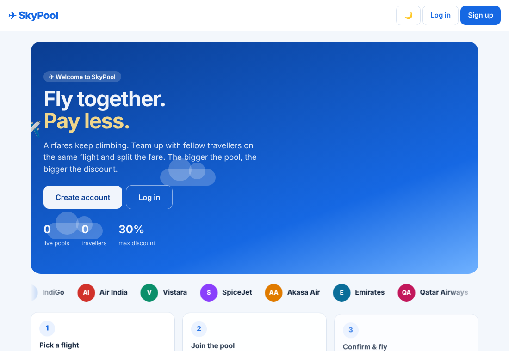
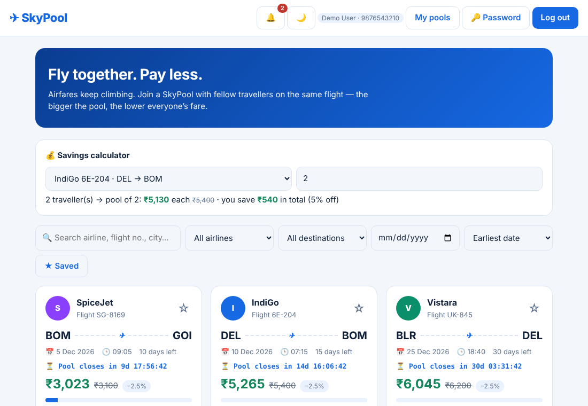
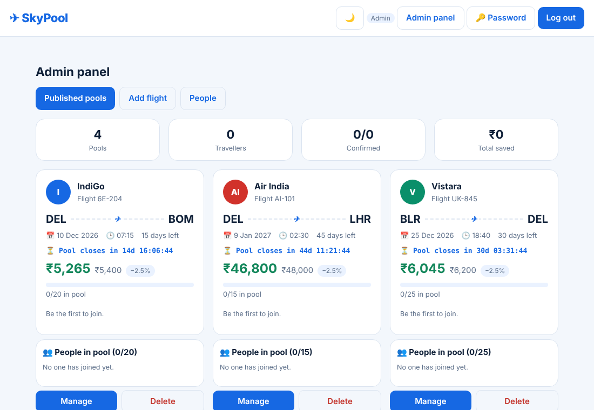

# ✈ SkyPool

### Fly together. Pay less.

SkyPool lets travellers **group-book the same flight** so everyone gets a lower fare. Every person who joins a flight pool unlocks a bigger discount for the whole group: **2.5% off per member, up to 30%**.

**Live demo:** [skypool-blond.vercel.app](https://skypool-blond.vercel.app)



---

## The problem
Airfares keep climbing, and solo travellers pay full price. Groups can negotiate better deals, but strangers heading to the same place on the same day have no way to team up.

## The solution
Airlines or admins publish a **flight pool**. Travellers browse pools and join with just a 10-digit ID. As the pool fills, the price drops for every member. Close to departure, members confirm their seats.

**Example:** an IndiGo DEL → BOM flight has a base fare of ₹5,400.

| Members in pool | Discount | Fare per person |
|---|---|---|
| 1 | 2.5% | ₹5,265 |
| 4 | 10% | ₹4,860 |
| 8 | 20% | ₹4,320 |
| 12+ | 30% (max) | ₹3,780 |

---

## Features

### For travellers
- **Welcome, login and signup pages** with name, 10-digit ID and password
- **Browse flight pools** with airline logo, route, date, live countdown and a pool progress bar
- **Join or leave a pool.** Cards show only the pool count; tap a card for the flight details page, where logged-in travellers see member IDs (never names)
- **Confirm your seat** within 3 weeks of departure. A confirmed passenger can **apply for cancellation**; the ticket is cancelled once the admin approves
- **Search, filter and sort** by airline, destination, date, and fare
- **Favourite pools** and a **notification centre** (joined, confirmation open, pool almost full, departure soon)
- **Savings calculator** to see what a pool of any size would cost you
- **Light and dark theme**, plus change password

### For admins
- **Add flights:** number, route, date, time, base fare, pool limit, logo upload
- **Open a pool's details page** to see every passenger with name, ID and status, and **remove** passengers (only passengers confirm their own seat)
- **Cancel requests tab:** approve (passenger removed from the pool) or decline cancellation requests
- **Edit pool details and limit**
- **Dashboard stats:** pools, travellers, confirmations, total money saved
- **People tab** with search and **reset a customer's password**
- **Load demo flights** with one click, handy for presentations




---

## Tech stack
| Layer | Choice |
|---|---|
| Front end | Plain HTML, CSS and JavaScript (ES modules), no framework and no build step |
| Database | Firebase Firestore (falls back to browser `localStorage` if no Firebase key is set) |
| Hosting | Vercel (static files + 2 serverless functions) |
| Auth | Name, 10-digit ID and SHA-256 hashed password |

## Project structure
```
index.html  login.html  signup.html  mine.html  flight.html  account.html  admin.html   ← one page each
css/styles.css                                                            ← all styles
js/config.js        loads runtime config from /api/config
js/actions.js       join/confirm/cancel/remove actions shared by pages
js/state.js         state, Firestore/localStorage store, helpers
js/ui.js            header, notifications, theme, navigation, render loop
js/views/*.js       page templates + actions (home, welcome, auth, mine, account, admin)
js/pages/*.js       small entry script per page
api/config.js       serves Firebase config + admin ID from environment variables
api/admin-check.js  checks the default admin password on the server
firestore.rules     Firestore security rules (demo, see Security)
```

---

## Run it locally
1. Install the Vercel CLI: `npm i -g vercel`
2. Copy `.env.example` to `.env.local` and fill in the values (see below)
3. Run `vercel dev` and open the printed `localhost` address

With `FIREBASE_API_KEY` left empty, the app stores everything in your browser, which is fine for a quick try-out.

## Environment variables
Set these in **Vercel → Project → Settings → Environment Variables** (or in `.env.local` locally).

| Name | Purpose |
|---|---|
| `FIREBASE_API_KEY` | Firebase web app API key (leave empty for browser-only storage) |
| `FIREBASE_AUTH_DOMAIN` | e.g. `your-project.firebaseapp.com` |
| `FIREBASE_PROJECT_ID` | Firebase project ID |
| `FIREBASE_APP_ID` | Firebase web app ID |
| `ADMIN_ID` | Admin login ID (default `admin`) |
| `ADMIN_PASSWORD` | Initial admin password (**required**). Change it in the app after first login |

## Deploy on Vercel
1. Push this repo to GitHub, then in Vercel choose **Add New Project** and import it
2. Framework preset **Other**, no build command, no output directory
3. Add the environment variables above and deploy (redeploy after changing any variable)
4. In the Firebase console: **Firestore → Create database**, then paste `firestore.rules` under Rules
5. In **Authentication → Settings → Authorized domains**, add your `*.vercel.app` domain

## Try it
1. Log in as the admin (`ADMIN_ID` / `ADMIN_PASSWORD`) and click **Load demo flights**
2. Log out, sign up as a traveller with any 10-digit ID, and join a pool
3. Watch the fare drop as more people join, then check **My pools** and the notification bell

---

## Security
This is a hackathon prototype, so read this before using it with real data:
- Firebase web config values are **public by design**. Real protection comes from Firestore rules
- `firestore.rules` is currently **fully open** (demo only), and login checks run in the browser
- Before real use, add **Firebase Authentication**, write strict Firestore rules, and restrict the API key by HTTP referrer in Google Cloud Console
- The default admin password is checked on the server and is never shipped to the browser

## Future scope
- Real payments and airline/booking API integration
- Firebase Authentication and strict security rules
- Email / SMS / push notifications
- Automatic pool refunds if a pool does not reach its minimum size
- Route-based pool suggestions and flexible-date matching
